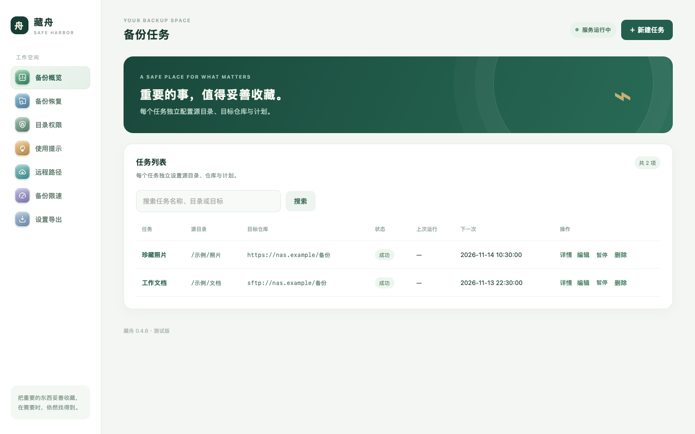

<div align="center">
  

  # 藏舟

  **把重要的东西妥善收藏，在需要时依然找得到。**

  面向飞牛 fnOS 的加密备份应用 · Kopia 快照 · WebDAV / SFTP

  [下载安装包](https://github.com/KnotDing/cangzhou/releases/tag/v0.4.6) · [Gitea 发布页](https://gitea.knotding.com/knot/cangzhou/releases) · [开始使用](#安装和首次备份) · [开发构建](#开发与构建)
</div>

藏舟运行在源 NAS 上，通过 WebDAV 或 SFTP 将数据备份到另一台设备。Kopia 负责加密仓库和快照，藏舟提供任务管理与嵌入飞牛的应用界面。



<p align="center"><sub>备份概览 · 截图使用模拟任务和示例地址</sub></p>

当前安装包为 **0.4.6，x86-64，要求 fnOS 1.1.3100 或以上**。它通过飞牛统一网关在应用窗口中打开，需要飞牛管理员身份。

- [GitHub Releases](https://github.com/KnotDing/cangzhou/releases)：提供 FPK、源码包和校验文件
- [本版本测试说明](releases/0.4.6/README.md)

本地工作目录若保留了现成安装包，可从 `dist/` 找到；构建产物不纳入 Git。

> 藏舟仍处于测试阶段。0.4.6 已通过本机自动化测试与模拟服务测试，但尚未完成真实飞牛网关、实际 WebDAV、大文件、网络中断和长时间运行验证。请先用可丢弃的数据做完整备份和恢复，并保留其他备份。升级前请等待正在运行的任务结束。

## 功能

- **备份任务**：创建多个任务，分别设置源目录、目标仓库、仓库密码和计划；支持查看详情、立即运行、编辑、暂停和删除。仓库操作串行执行。
- **远程路径**：独立保存 WebDAV 或 SFTP 连接，多个任务可共用；保存前可测试目录访问。修改连接时会先验证关联任务，全部成功后才切换。
- **快照和恢复**：浏览历史快照并恢复到应用私有目录，也可以下载恢复结果的 ZIP。支持从 NAS 已授权目录中的 Kopia 仓库或 ZIP，以及通过浏览器上传 ZIP，进行离线恢复。
- **计划和限速**：间隔以小时设置，0 为手动；可设置全局和单任务上传限速，两者同时设置时取较低值。
- **设置导入与导出**：导出任务、连接和限速配置；导入时按编号合并，重复项跳过，并在保存前验证新增任务的仓库连接。

## 安装和首次备份

1. 从发布页下载 FPK，或使用本地构建的 FPK，在源飞牛应用中心手动安装。如果是升级，请先确认备份已结束。
2. 在飞牛的应用设置中，为藏舟授予备份源目录的读取权限。应用只使用系统提供的授权路径，不会假定 `/vol1` 或其他卷可访问。
3. 在目标设备启用 WebDAV 或 SFTP，准备账号和可访问的上级目录。在藏舟的「远程路径」中填写连接信息，先测试，再保存。
4. 在「备份概览」新建任务，选择已保存的远程路径，填写源目录、仓库子目录、计划及至少 12 字节的仓库密码。选择「新建仓库」时，藏舟会尝试创建缺失的目标目录；选择「连接已有仓库」时不会创建。
5. 创建任务后手动运行一次备份，在「历史快照」中检查并恢复测试数据，确认内容可用。

**请独立保存仓库密码。** 仓库密码用于解密快照；遗失后不能依靠重新安装应用恢复数据。

### 连接说明

- WebDAV 支持 HTTP 和 HTTPS。HTTP 会明文传输账号密码；HTTPS 默认校验证书，也可选择跳过校验，但跳过后无法确认服务器身份。连接测试只读取目录信息，不证明写入权限。
- SFTP 支持密码或无口令私钥。需要提供服务器的 `known_hosts` 主机密钥，并通过可信渠道核对；非 22 端口通常使用 `[主机]:端口 密钥类型 公钥` 格式。带口令私钥和 SMB 当前不支持。
- 已有任务引用的连接不能直接删除；先将任务切换到其他连接。删除任务或连接不会删除远端仓库。

### 调度、进度和空间

暂停只阻止后续运行，不会中止已开始的备份。恢复定时任务后，从当前时间重新计算下一次执行时间。任务详情中的已处理大小包含已复用文件；总量和剩余时间来自 Kopia 估算，无法可靠估算时显示「估算中」。备份成功后会自动统计仓库大小；统计失败保留上次成功值，不改变备份成功状态。

仓库大小是**整个仓库对象的字节总量**，不是单个任务独占空间。上传限速只作用于备份写入仓库，修改后下一次备份生效；Kopia 的限速可能出现短时突发，不限制恢复下载或其他应用。

### 恢复与设置文件

在线恢复从任务的「历史快照」进入；离线恢复从「备份恢复 → 离线恢复」进入。离线仓库只读打开，NAS 侧的仓库路径必须位于已授权目录。ZIP 应包含完整的 Kopia 仓库或单层仓库目录，不支持加密 ZIP；本地仓库不能包含符号链接或特殊文件。浏览器上传上限为 64 GiB、解压后上限为 256 GiB，实际还受飞牛网关和可用空间限制。关闭离线仓库会清理临时副本，异常中断可能留下临时文件。

恢复文件保存在应用私有目录；下载的 ZIP **不包含符号链接和特殊文件**。设置导出的 JSON 不包含备份数据、快照或 Kopia 连接文件。默认不包含密码和 SFTP 私钥；主动勾选后，它们以明文写入文件。导入时如未包含凭据，需要补填；新设备上的源目录仍需重新授权。

## 凭据与权限边界

藏舟以飞牛分配的应用用户运行，并从 `TRIM_DATA_ACCESSIBLE_PATHS` 读取系统下发的授权目录。这个路径列表不区分只读和读写；应用会结合实际用户权限检查，目录本身可读也不保证所有子项都可读。授权变更通过应用回调处理，具体时序和权限隔离仍应在目标 fnOS 版本验证。

自动任务需要在应用私有目录保存 WebDAV/SFTP 凭据、SFTP 私钥和仓库密码；设备管理员可能读取这些文件。网关入口使用管理员身份、CSRF 防护和 Unix socket 对端身份检查；同一系统用户下的其他本机进程属于同一信任范围。请勿将应用私有文件、日志或包含密码的设置导出文件公开分享。

## 开发与构建

源码使用 Go **1.24 或以上**，依赖已放在 `core/vendor/`。安装包包含 Kopia **0.23.1** 的 Linux x86-64 可执行文件；源码包不包含该二进制文件。构建 FPK 还需要安装飞牛 `fnpack`；本项目之前使用过 1.2.3。

运行测试：

```sh
cd core
go test ./...
go test -race ./...
```

测试需要允许本机回环连接；竞态检查需要支持 Go race 的环境。要运行使用实际 Kopia 的本地仓库、离线恢复和 SFTP 测试，请提供与开发机器架构匹配的 Kopia 可执行文件：

```sh
cd core
CANGZHOU_TEST_KOPIA=/absolute/path/to/kopia go test -race ./...
```

不设置 `CANGZHOU_TEST_KOPIA` 时，相应集成测试会跳过。构建安装包应使用经核验的 **Linux x86-64** Kopia；`fnpack` 则应匹配执行构建的机器。

Kopia 可从[官方发布页](https://github.com/kopia/kopia/releases/tag/v0.23.1)获取；请核对对应平台及官方校验信息。`fnpack` 可从[飞牛开放平台](https://developer.fnnas.com/)获取。Linux x86-64 CI 可使用 `scripts/fetch-ci-tools.sh` 下载并验证固定版本的工具。更多开发约定见 [AGENTS.md](AGENTS.md)。

### 从当前源码构建 FPK

`packaging/fnos/` 是当前受版本管理的打包模板，不含 Kopia 和编译后的服务程序。构建脚本使用当前 Git 提交生成源码包；请先提交更改，确保源码包与安装包一致。

```sh
# 从项目根目录执行；路径都需为绝对路径。
FNPACK=/absolute/path/to/fnpack \
KOPIA=/absolute/path/to/verified-linux-x86_64-kopia \
  ./scripts/build-fpk.sh
# artifacts/ 中包含 FPK、源码包和 SHA256SUMS。
```

旧版 `releases/` 源码归档中的构建说明只适用于该归档。GitHub 和 Gitea 工作流、版本标签要求及发布行为见 [CI 和发布说明](docs/ci.md)。

## 项目目录

| 路径 | 内容 |
| --- | --- |
| `core/` | 当前应用源码、测试和 vendored Go 依赖 |
| `core/cmd/cangzhou/` | Web 界面、任务、远程连接、恢复和持久化 |
| `core/internal/authority/` | fnOS 授权路径解析和访问检查 |
| `packaging/fnos/` | 当前 fnOS 打包模板；程序二进制在构建时填入 |
| `scripts/` | CI 工具下载、FPK 构建与 Gitea 发布脚本 |
| `.github/workflows/`、`.gitea/workflows/` | 两个平台的测试和发布工作流 |
| `releases/` | 历史版本模板和测试说明；本地可能保留未跟踪的源码包 |
| `dist/`、`artifacts/` | 本地生成的 FPK 和构建产物，不纳入 Git |
| `design/` | 应用图标素材和生成脚本 |
| `docs/` | 使用及持续集成相关说明、界面图片 |

运行时配置位于飞牛提供的 `TRIM_PKGVAR` 应用私有目录，包含 `state.json`、每个任务的 Kopia 连接文件和日志、缓存及恢复结果。设备上可先查看 `/var/apps/cangzhou/var/server.log`；任务的 Kopia 日志位于该目录下对应的 `jobs/<任务编号>/logs/cli-logs/`。发送日志前请遮掉地址、账号、密码和令牌。

## 参考

- [Kopia 文档：仓库和连接方式](https://kopia.io/docs/repositories/)
- [飞牛开放平台](https://developer.fnnas.com/)
