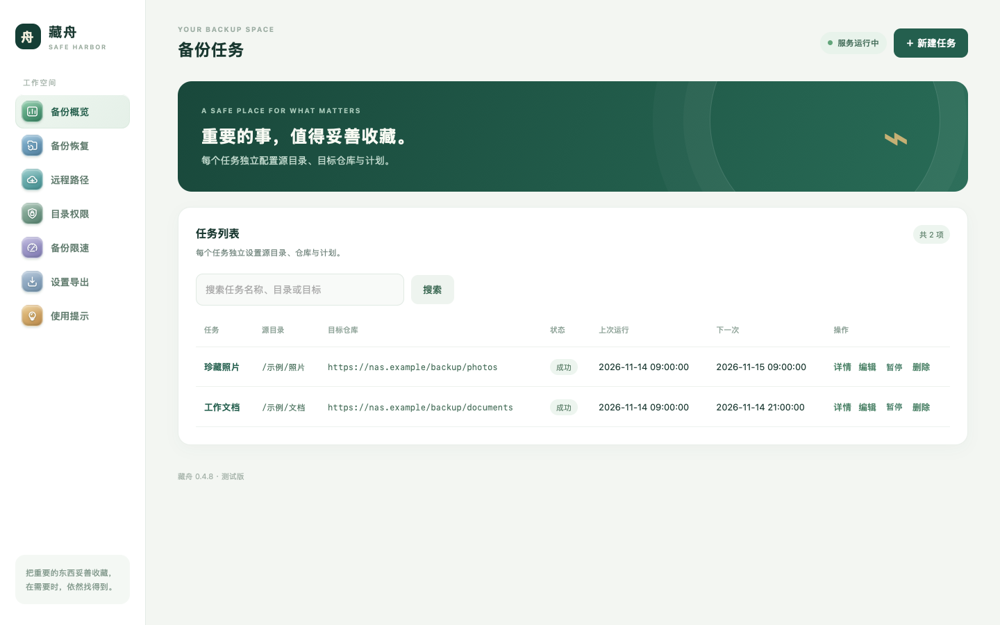
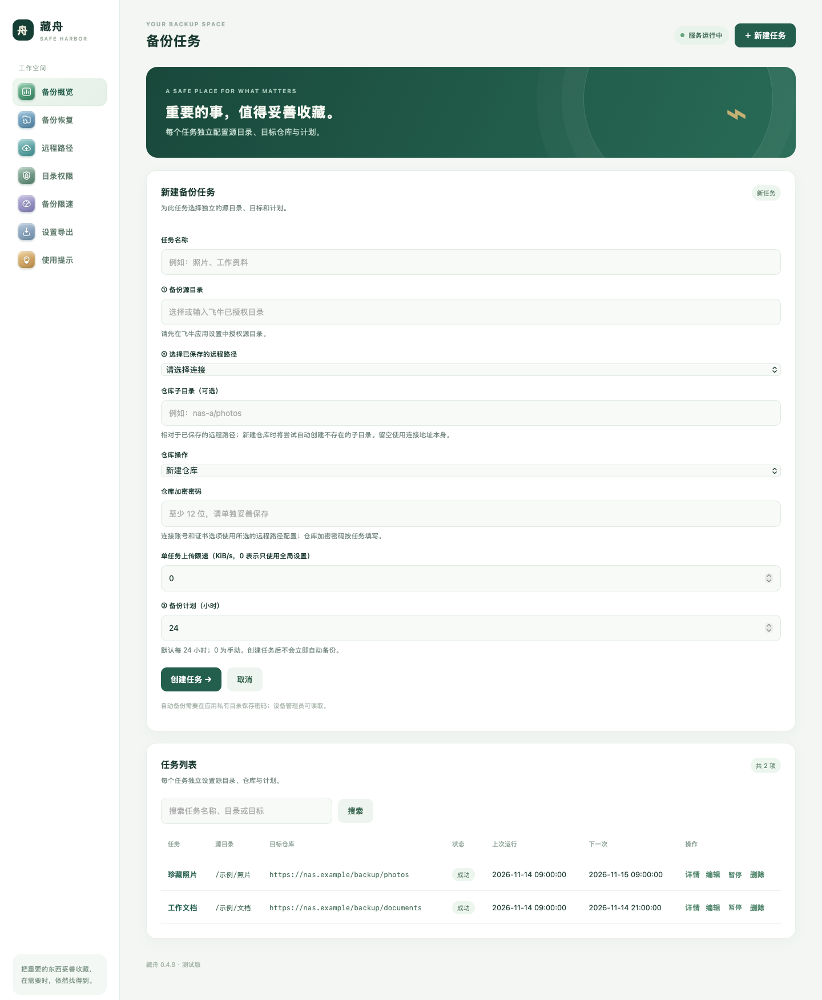
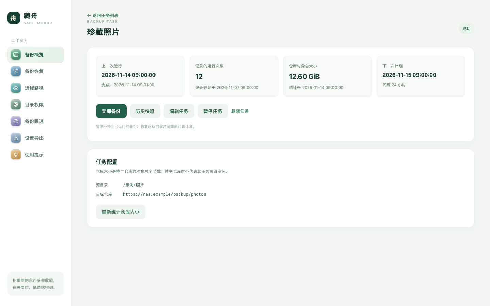
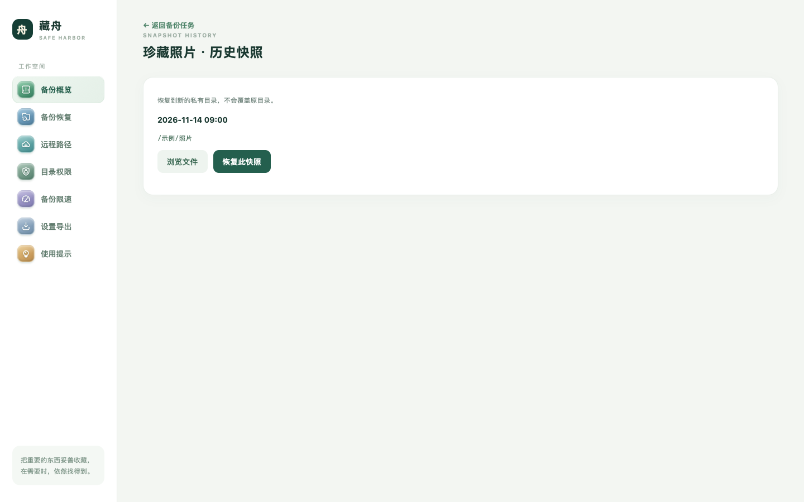
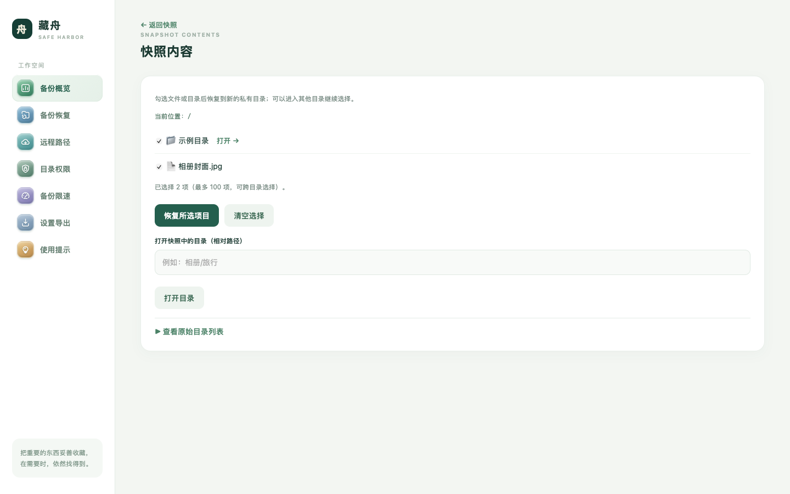
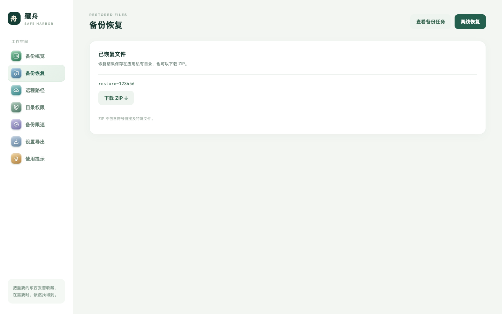
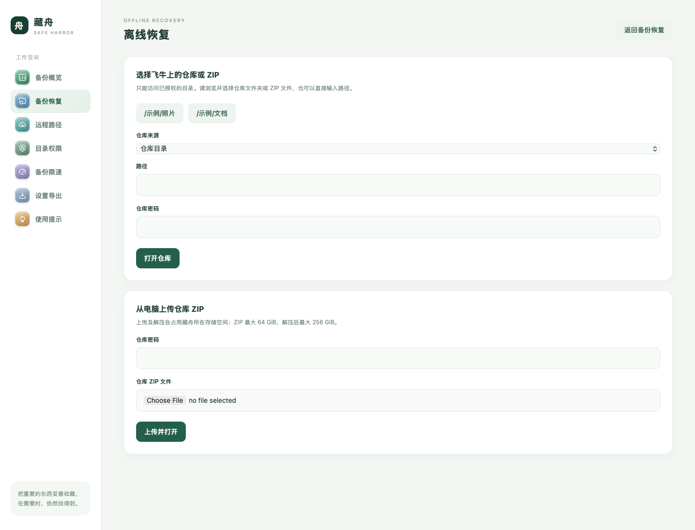
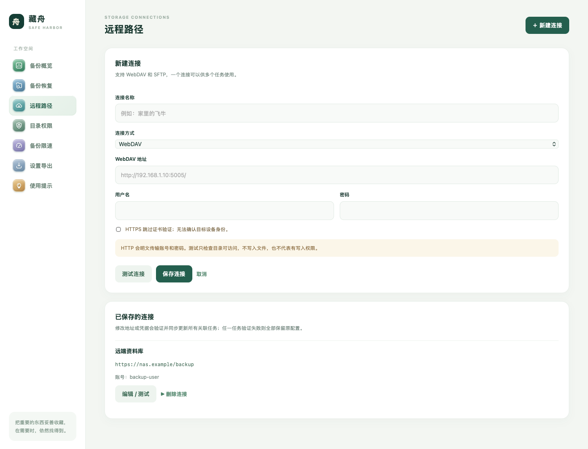
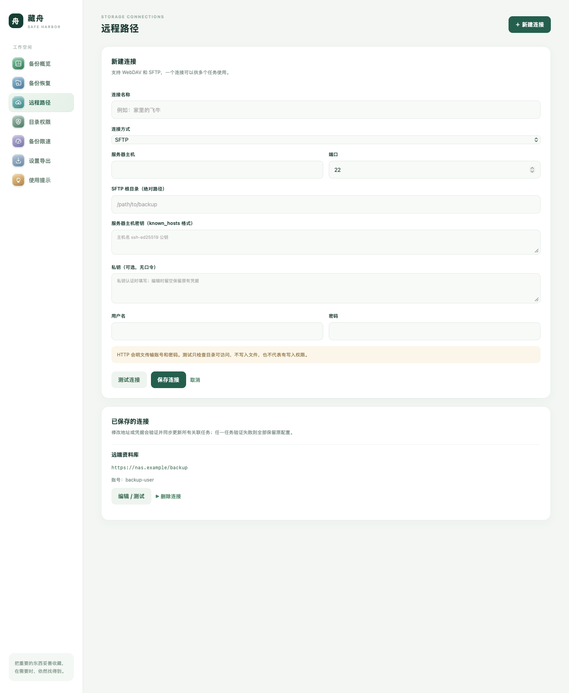

<div align="center">
  

  # 藏舟

  **把重要的东西妥善收藏，在需要时依然找得到。**

  面向飞牛 fnOS 的加密备份应用 · 基于 Kopia · 支持本地、WebDAV 和 SFTP

  [下载](https://github.com/KnotDing/cangzhou/releases) · [Gitea 发布页](https://gitea.knotding.com/knot/cangzhou/releases) · [安装与使用](#安装与使用) · [开发与构建](#开发与构建)
</div>

藏舟运行在源飞牛设备上，将选定目录备份到本地目录或 WebDAV、SFTP 远程仓库。它使用 Kopia 创建加密快照，并提供备份计划、历史记录、文件浏览和恢复界面。



<p align="center"><sub>备份概览 · 截图使用模拟数据，来自 0.4.8，界面以实际版本为准</sub></p>

> 自动化和本地集成测试不能代替真实设备验证；真实飞牛网关、实际 WebDAV、大文件、网络中断及长时间运行等场景仍需进一步验证。请先使用可丢弃的数据完成备份和恢复测试，并保留其他备份。

## 功能

- **加密备份**：使用 Kopia 加密仓库和快照，将备份保存到本地目录或通过 WebDAV、SFTP 保存到远程位置。
- **任务管理**：创建多个备份任务，分别设置源目录、仓库位置、执行间隔和上传限速；支持手动运行、编辑和暂停。
- **历史任务**：查看任务开始时间、耗时、状态、传输大小、仓库大小和触发方式。
- **快照浏览与恢复**：浏览在线快照，选择文件或目录恢复；也可从已授权目录或上传的仓库 ZIP 进行离线恢复。
- **设置迁移**：导出和导入任务、连接及限速配置；默认导出不包含密码和私钥。

[查看界面截图](#界面一览)

## 安装与使用

### 系统要求

- **fnOS 1.1.3100 或以上，x86-64 或 ARM64 设备**；通过飞牛应用窗口访问，需要管理员身份。
- 本地仓库需要已授权、可读写的现有目录；远程仓库需要可访问的 WebDAV 或 SFTP 服务和相应权限。
- 飞牛为藏舟授予的备份源目录访问权限。

### 安装

1. 从 [GitHub Releases](https://github.com/KnotDing/cangzhou/releases) 或 [Gitea 发布页](https://gitea.knotding.com/knot/cangzhou/releases)下载适用于设备的 FPK（`-x86.fpk` 对应 x86-64，`-arm.fpk` 对应 ARM64）和同一发布页的 `SHA256SUMS`。ARM64 包从 0.4.10 开始提供。
2. 在下载目录核对文件：只下载了一个架构时，Linux 使用 `grep "  文件名.fpk$" SHA256SUMS | sha256sum -c -`，macOS 使用 `grep "  文件名.fpk$" SHA256SUMS | shasum -a 256 -c -`，将文件名替换为实际下载的 FPK 文件名。两个平台可能分别构建安装包，请使用下载来源对应的校验文件。
3. 在飞牛应用中心手动安装 FPK。升级时请先等待正在运行的任务结束。
4. 在应用设置中授权需要备份的源目录，然后以管理员身份打开藏舟。

### 创建并验证备份

1. 使用远程仓库时，在「远程路径」中添加 WebDAV 或 SFTP 连接，测试后保存。连接测试只读取目录信息，不能证明目标目录可写。本地仓库无需添加远程连接。
2. 在「备份概览」新建任务，选择本地目录或远程路径，填写源目录、执行间隔及至少 12 字节的仓库密码；远程仓库可填写仓库子目录。间隔为 `0` 时仅手动运行。
3. 选择「新建仓库」或「连接已有仓库」。远程新建时会尝试创建缺失的目标目录；本地仓库目录须事先存在，连接已有仓库不会创建目录。
4. 手动运行一次备份，进入「历史快照」浏览并恢复测试数据，确认恢复结果可用。

**请独立保存仓库密码。** 仓库密码用于解密快照，遗失后重新安装应用也无法找回数据。

### 查看与恢复

在任务详情中打开「历史任务」查看运行记录，或打开「历史快照」浏览和恢复在线快照。恢复结果保存到新的应用私有目录，可从「备份恢复」下载 ZIP。

离线恢复从「备份恢复 → 离线恢复」进入，可打开已授权目录中的 Kopia 仓库或仓库 ZIP，也可通过浏览器上传仓库 ZIP。离线仓库以只读方式打开。

在线和离线浏览均支持跨目录选择最多 100 个普通文件或目录，并保留所选项目的相对路径。符号链接、特殊文件，以及含控制字符或反斜杠的路径不能单独选择；下载的 ZIP 不包含符号链接和特殊文件。单个目录列表超过 4 MiB 时会截断，可输入相对路径进入未显示的子目录。

## 使用说明

### 仓库位置

- 本地仓库请选择已授权的现有目录，仓库与备份源目录不能相同或互相包含。仓库和源数据处于同一设备时，无法抵御整机或存储故障。
- WebDAV 支持 HTTP 和 HTTPS。HTTP 会明文传输账号密码；HTTPS 默认校验证书，跳过校验会失去服务器身份验证。
- SFTP 支持密码或无口令私钥，需要提供并核对服务器的 `known_hosts` 主机密钥。非 22 端口通常使用 `[主机]:端口 密钥类型 公钥` 格式。暂不支持带口令私钥和 SMB。
- 多个任务可复用同一远程连接。修改连接前会验证关联任务；删除任务或连接不会删除远端仓库。

### 计划、记录与空间

- 仓库操作串行执行。暂停任务只阻止后续运行，不会中止已经开始的备份；恢复定时任务后，从当前时间重新计算下一次运行时间。
- 历史任务从 0.4.9 开始记录，每个任务最多保留最近 200 次，旧版本未保存的记录无法补回。传输大小是运行时最后一次报告的上传量，可能不完整；没有数据时显示「未知」。
- 进度中的已处理大小包含复用的文件，预计总量和剩余时间来自 Kopia 的估算。仓库大小是**整个仓库对象的字节总量**，共享仓库时不代表单个任务独占的空间。
- 备份成功后自动统计仓库大小；统计失败不会改变备份成功状态。详情保留上次成功的统计结果，本次历史记录则显示「未知」。
- 全局与单任务上传限速同时设置时使用较低值，修改后从下一次备份生效。限速仅作用于备份写入，可能出现短时突发，不限制恢复下载或其他应用。

### 离线恢复与设置文件

- 离线 ZIP 应包含完整的 Kopia 仓库或单层仓库目录，不支持加密 ZIP；本地仓库不能包含符号链接或特殊文件。浏览器上传上限为 64 GiB，解压后上限为 256 GiB，实际还受飞牛网关和可用空间限制。关闭离线仓库会清理临时副本，异常中断可能留下临时文件。
- 设置导出不包含备份数据、快照或 Kopia 连接文件。默认不包含密码和 SFTP 私钥；主动勾选后，这些凭据会以明文写入导出文件。导入时相同编号的已有项目会跳过，未包含的凭据需补填，新设备上的源目录需重新授权。

### 凭据与权限

藏舟以飞牛分配的应用用户运行，只使用系统下发的授权目录并检查实际访问权限。目录已授权不代表所有子项均可读取；授权变更的时序和隔离效果请在目标 fnOS 版本上验证。

自动备份需要在应用私有目录保存远程连接凭据和仓库密码，设备管理员可能读取这些文件。请勿公开分享应用私有文件、未脱敏日志或包含密码的设置导出文件。

## 界面一览

以下截图来自 0.4.8，使用模拟数据；0.4.9 的任务详情增加了「历史任务」入口。

<details>
<summary>任务与快照</summary>






</details>

<details>
<summary>恢复与远程路径</summary>






</details>

## 开发与构建

当前源码位于 `core/`，使用 Go 1.24 或以上版本，依赖已存放于 `core/vendor/`。`package/` 是当前 FPK 模板，`scripts/` 包含构建和发布脚本。

运行测试：

```sh
cd core
go test ./...
go test -race ./...
```

部分测试需要本机回环连接。提供与开发机器架构匹配的 Kopia 可执行文件，可额外运行本地仓库、离线恢复和 SFTP 集成测试；未设置时这些测试会跳过：

```sh
CANGZHOU_TEST_KOPIA=/absolute/path/to/kopia go test -race ./...
```

从**干净的 Git 提交**构建 FPK，在项目根目录执行：

```sh
FNPACK=/absolute/path/to/fnpack \
KOPIA=/absolute/path/to/verified-linux-x86_64-kopia \
  ./scripts/build-fpk.sh
```

构建 ARM64 包时，将 `KOPIA` 指向经核验的 Linux ARM64 Kopia，并设置 `CANGZHOU_ARCH=arm`；默认值 `x86` 生成 x86-64 包。产物位于 `artifacts/`，每次构建生成当前包的 `SHA256SUMS`，连续构建两种架构时需重新生成包含两个包的校验文件。构建机的 `fnpack` 必须与构建机架构匹配；当前使用 Kopia 0.23.1 和 fnpack 1.2.3。Linux x86-64 环境可使用 `scripts/fetch-ci-tools.sh` 获取并校验固定版本工具。源码归档不包含 Kopia 二进制。

更多细节见 [开发指引](AGENTS.md)和 [CI 与发布说明](docs/ci.md)。

## 问题排查

设备上的服务日志可先查看 `/var/apps/cangzhou/var/server.log`；任务的 Kopia 日志位于应用私有目录下 `jobs/<任务编号>/logs/cli-logs/`。反馈问题时，请提供版本、操作步骤和错误现象，并先从日志和截图中移除地址、账号、密码及令牌。

## 参考

- [Kopia 文档：仓库和连接方式](https://kopia.io/docs/repositories/)
- [飞牛开放平台](https://developer.fnnas.com/)
